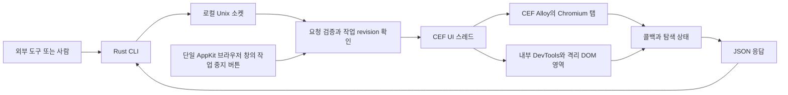

# Naru 아키텍처와 구현 단계

Naru는 사람이 사용하는 Chromium 브라우저를 로컬 CLI에서도 읽고 제어하는 macOS 앱이다. Rust 앱이 브라우저와 작업 상태를 보관한다. CLI는 요청 한 번을 전달하고 종료한다. 앱 실행에 Node 런타임이나 MCP 서버는 필요하지 않다.

프로젝트 이름은 Naru지만 현재 앱 번들, 실행 파일, 프로필 식별자는 `Light Browser.app`, `lightbrowser`, `local.lightbrowser.dev`를 사용한다. 이름 변경과 프로필 이전은 별도 작업이다.

## 제품 목표와 재사용 경계

Naru를 먼저 독립 브라우저로 완성한 뒤, 같은 Rust·CEF 브라우저 기능을 Preseller 내부에 내장한다. 독립 앱의 사용성과 CLI를 계속 개발하며 창·앱 수명주기와 공통 브라우저 구현의 의존성을 나눌 준비를 한다. 현재 외부 호스트를 받는 API나 공통 코어 패키지는 없으며, 아래 요청 흐름은 독립 앱의 실제 구현이다. 후속 구조와 완료 기준은 [독립 완성과 내장 계획](preseller-integration.md)을 따른다.

## 현재 구현과 후속 범위

| 영역 | 현재 구현 | 후속 범위 |
| --- | --- | --- |
| 브라우저 | Rust, CEF Alloy, Chromium, 단일 AppKit 창, 접는 세로 탭과 공간 카드 | 공간 전환과 창 수명주기의 실행 검증 확대 |
| 표시 공간 | 내 공간과 작업별 공간, 공간별 선택, 요청 시 대표 탭 미리보기 | 여러 공간의 사용성 검증 |
| 제어 | 로컬 CLI, 탐색, DOM 조작, 캡처, 작업 상태와 중지 버튼 | 페이지 본문에서 사용자 입력 감지 |
| 관찰 | 메인 문서와 열린 Shadow DOM, 참조, viewport, 탐색·렌더러 상태 | iframe, 접근성 정보 등 범위 확장 |
| 입력 | 합성 DOM 클릭·입력·Enter, 제어권 변경 시 요청과 참조 만료 | CEF 입력 이벤트 |
| 제어권 | 작업별 소유권과 revision, CLI의 handoff와 resume, 네이티브 탐색과 새 탭 조작 전 handoff | 페이지 본문 클릭과 입력 감지 후 자동 중단 |
| AI | 외부 프로그램이 CLI 사용 가능, 내장 모델 연결 없음 | 모델 연결, 페이지 정보 전송과 실행 승인 정책 |
| 배포 | 프로젝트 안에서 빌드, 개발용 ad hoc 서명과 산출물 정리 | 지속 서명, 공증, 배포와 업데이트 |

작업 공간은 탭을 묶는 논리적 단위다. 별도 브라우저 프로필이나 별도 로그인 세션을 만들지 않는다. 모든 작업은 같은 앱의 프로필을 공유하므로 쿠키와 로그인 상태도 공유한다. 작업 소유권은 같은 macOS 사용자 안에서 명령 충돌을 줄이기 위한 규칙이며, 서로 신뢰하지 않는 사용자나 프로그램을 격리하는 인증 수단은 아니다.

## 요청과 실행 흐름



`src/bin/cli.rs`가 `src/cli.rs`의 인자 파서를 호출한다. `src/protocol.rs`는 요청과 응답 형식을 정의하고 소켓 연결, 사용자와 파일 권한 검사를 담당한다. 요청 하나마다 연결 하나를 사용하며, CLI 프로세스가 끝나도 앱의 탭과 작업은 유지된다.

`src/main.rs`는 프로필, 소켓, CEF 런타임을 준비한 뒤 `src/browser.rs`의 서버와 CEF 메시지 루프를 시작한다. 소켓 요청은 CEF UI 스레드에 전달된다. 브라우저 상태 변경과 작업 소유권 검사는 이 스레드에서 처리해야 한다. 대기 중인 요청이 다른 연결을 막지 않도록 소켓 연결은 독립적으로 처리한다.

페이지 관찰과 조작은 `src/browser.rs`의 내부 DevTools 요청에서 시작한다. 메인 프레임과 격리 실행 영역을 확보한 뒤 `src/dom_bridge.js`를 실행한다. 외부 디버깅 포트를 열지는 않는다. 페이지가 정의한 같은 이름의 JavaScript 객체를 신뢰하지 않는다.

`src/mac.rs`는 macOS 앱 이벤트와 브라우저 단축키를 연결하고, `src/control_panel.rs`는 단일 AppKit 브라우저 창을 구성한다. 창 안의 중지 버튼은 `src/browser.rs`의 기존 TaskHandoff 처리 경로를 호출한다. `src/bin/helper.rs`는 CEF 보조 프로세스와 sandbox 초기화를 담당한다. 런타임은 고정된 CEF 156.0.1 beta이며 로컬 파생 바인딩과 API 15600을 함께 사용한다. 버전 교차 검증과 앱 시작 시 API 해시 확인은 서로 다른 CEF 조합의 실행을 막는다.

`src/tasks.rs`는 CLI 작업 소유권과 revision을 관리한다. `src/spaces.rs`는 표시 공간, 공간별 탭 선택, 빌린 탭의 원래 공간을 관리한다. `src/browser.rs`가 작업 생성과 소유권 변경 뒤 두 상태를 맞추고 `src/control_panel.rs`에 스냅샷을 전달한다. 표시 공간과 작업 소유권은 별개다. 완료 공간에 남긴 결과 탭은 작업 소유권 없이도 그 공간에 표시할 수 있다.

## 작업 공간과 제어권

작업은 `id`, `name`, `status`, `revision`, `tabs`, `closingTabs`, `releasedTabs`를 가진다. `tabs` 항목은 `{tab, origin}` 형식이며 `origin`은 `created` 또는 `borrowed`다. 나머지 두 배열에는 탭 ID가 들어간다.

| 명령 | 의미 |
| --- | --- |
| `task create NAME` | revision 1인 active 작업 생성 |
| `task list`, `task info ID` | 앱에 남아 있는 작업 상태 조회 |
| `task run ID REV COMMAND...` | 해당 작업의 현재 제어권으로 기존 명령 실행 |
| `task adopt ID REV TAB` | 기존 탭을 borrowed로 연결 |
| `task release ID REV TAB` | 탭을 닫지 않고 작업에서 분리 |
| `task handoff ID REV` | active 작업을 paused로 바꾸고 revision 증가 |
| `task resume ID REV` | paused 작업을 active로 바꾸고 revision 증가 |
| `task finish ID REV [--keep TAB...]` | revision을 증가시키고 작업 종료 시작 |

내 공간 ID는 `user`이며 작업 공간 ID는 작업 ID와 같다. 작업을 생성하면 탭 없는 공간이 목록에 생기지만 CEF 탭이나 다른 프로필은 만들지 않는다. 현재 보고 있는 공간도 바꾸지 않는다.

| 명령 | 표시 동작 |
| --- | --- |
| `spaces` | 모든 공간과 현재 공간, 선택 탭, overview 상태 조회 |
| `task run ID REV spaces` | 현재 revision을 검사하고 해당 작업의 공간 항목만 조회 |
| `space show user` | 내 공간과 그 공간에 저장된 선택 탭 표시 |
| `space show ID` | 해당 작업 공간과 그 공간에 저장된 선택 탭 표시 |
| `space overview` | 현재 공간의 선택을 보존한 채 공간 목록 표시 |

세 표시 명령의 응답에는 `spaces`, `activeSpace`, `activeTab`, `overview`가 있다. 공간 항목은 `id`, `name`, `kind`, `status`, `revision`, `tabs`, `selectedTab`, `active`를 가진다. `kind`는 `user` 또는 `task`, `status`는 `user`, `active`, `paused`, `finishing`, `finished` 중 하나다. 빈 공간의 `selectedTab`은 `null`이다. overview에서 페이지 뷰가 숨겨져도 `activeTab`은 저장된 선택을 나타낸다. CLI 메타데이터만으로 실제 표시나 포커스를 판단하지 않는다.

`space show`와 `space overview`는 사용자 화면을 바꾸는 명시 명령이며 창을 앞으로 가져온다. 공간을 보는 것만으로 AI 제어권을 인계하지 않는다. 두 명령을 `task run` 안에서 실행하면 `SPACE_UI_REQUIRES_UNSCOPED`로 거부한다. 작업 범위의 `spaces`는 목록 항목만 제한하며 최상위 현재 화면 메타데이터는 그대로 반환한다.

adopt와 release는 revision을 바꾸지 않는다. handoff, resume, finish의 첫 상태 전환은 revision을 하나 증가시킨다. finishing 또는 finished 상태에서는 현재 revision과 빈 keep 목록으로만 finish를 다시 호출할 수 있으며 revision은 유지된다. 이때 keep 탭을 추가하면 `INVALID_KEEP`로 거부한다. 작업 관리 명령을 task run 안에 중첩하지 않는다.

`task run ... tabs`는 그 작업이 소유한 탭만 반환한다. 범위를 지정하지 않은 `tabs`는 전체 탭과 작업 소속을 볼 수 있다. 작업 소속 탭을 범위 없이 읽거나 조작하면 `TASK_REQUIRED`가 발생한다. 다른 작업의 탭을 지정하면 `TASK_TAB_MISMATCH`, 이전 revision을 사용하면 `TASK_STALE_REVISION`, paused 작업에서 실행하면 `TASK_PAUSED`로 거부한다.

handoff는 CLI, 브라우저 상태 표시와 공간 카드의 중지 버튼으로 요청한다. 작업 소유 탭의 네이티브 주소창, 뒤로, 앞으로, 새로고침, 탭 닫기를 조작할 때도 먼저 소유 작업을 handoff한다. active 공간의 새 탭 버튼과 ⌘T도 해당 작업을 handoff한 뒤 사용자 탭을 같은 표시 공간에 만든다. 페이지 본문 안의 직접 클릭과 키 입력은 아직 감지하지 않으므로 본문 조작 전에는 명시적으로 인계해야 한다.

handoff 시 해당 작업의 대기 요청은 `TASK_CONTROL_LOST`로 끝나며 기존 요소 참조도 만료된다. 단순 대기는 실행 결과가 불명확한 변경 작업이 아니다. 이미 페이지에 전달된 변경 작업은 오류 상세의 `outcomeUnknown`을 확인해야 하며 자동 재시도하면 안 된다. resume 뒤에는 현재 revision으로 다시 읽고 새 참조를 사용한다.

탭을 adopt하기 전에 진행 중인 요청이 없어야 한다. 작업으로 연결한 뒤에도 이미 실행 중인 읽기나 조작과 겹치면 `TAB_BUSY`로 거부할 수 있다. 이 규칙은 작업을 연결하기 전에 시작한 요청이 이후 제어권을 벗어나 완료되는 문제를 막는다.

active 작업의 탭에서 생성한 팝업은 해당 작업의 created 탭으로 연결한다. paused 상태에서 사용자가 여는 팝업은 작업 소속 없이 유지하지만 opener와 같은 표시 공간에 넣는다. 팝업 생성 요청과 실제 탭 생성 사이에도 작업 상태가 바뀔 수 있으므로 생성 콜백에서 제어권을 다시 확인해야 한다.

## 단일 브라우저 창

AppKit NSWindow 하나와 공유 콘텐츠 뷰 안에 CEF Alloy의 Chromium 페이지 뷰를 넣는다. 왼쪽에는 접을 수 있는 세로 탭, 위쪽에는 주소창과 탐색 버튼을 배치한다. 세로 탭 목록에는 현재 표시 공간의 탭만 보인다. 공간 목록에서는 상태와 대표 탭의 작은 미리보기를 가진 카드로 전환한다. 새 작업 창이나 UI용 웹 renderer를 만들지 않는다.

UI는 중성 배경과 청록색 선택 표시를 사용한다. 탐색 막대는 44pt, 탭 행은 36pt이며 주소 입력 영역과 작업 상태 배지를 분리한다. SF Symbols는 고정된 아이콘 종류만 공유 캐시에 보관하고, 아이콘 버튼에는 접근성 이름과 도움말을 유지한다. 공간 카드에는 미리보기, 제목과 탭 정보, 상태 배지와 중지를 모아 표시한다. 창 너비에 따라 1~3열로 배치하고 기존 미리보기 이미지를 비율 유지·상단 중앙 기준으로 잘라 보여준다. 별도 확대 이미지나 디스크 캐시는 만들지 않는다. 네이티브 표면은 창의 유효 appearance에 맞춰 라이트·다크 색상을 선택한다.

범위 없는 CLI open은 내 공간에 새 탭을 배치한다. 내 공간을 보고 있고 overview가 아닐 때만 새 탭을 선택한다. 작업 범위의 open은 해당 작업 공간에 넣되 어느 공간을 보고 있든 기존 선택을 유지한다. 선택이 없는 공간은 첫 탭을 대표 탭으로 기록한다. 다른 탭에 대한 read와 screenshot도 현재 선택을 바꾸지 않는다. 팝업은 실제 opener의 작업 소유권과 표시 공간을 검사한 뒤 같은 콘텐츠 영역에 붙인다. 소유권은 계속 CEF browser ID 단위로 유지한다.

`target="_blank"`처럼 CEF가 새 탭이나 창으로 분류한 링크 요청은 `OnOpenURLFromTab`에서 받아 UI 작업 큐에 전달한다. 큐 실행 시 opener가 남아 있는지, 작업 소속, 상태, revision이 요청 시점과 같은지 확인한 뒤 새 CEF 탭을 만들고 생성 콜백에서도 다시 검사한다. 제어권이 바뀌거나 생성이 실패하면 원래 탭을 대신 이동시키지 않는다. active 작업의 생성은 현재 선택을 유지한다. 사용자 전경 요청은 현재 보고 있는 같은 공간에서만 새 탭을 선택하며 `NEW_BACKGROUND_TAB`은 기존 선택을 유지한다.

CLI의 `tab` 값, 작업의 `tabs`, `closingTabs`, `releasedTabs`, 요소 참조와 탐색 상태의 관리 단위는 계속 CEF browser ID다. 탭 선택이나 표시 위치가 바뀌어도 살아 있는 탭의 ID는 바뀌지 않는다. `status.windowMode`는 `single`, `status.activeSpace`는 현재 공간 ID, `status.activeTab`은 그 공간의 선택 탭 ID다. `status.overview`는 공간 목록 표시 여부다. `tabs`의 `space`는 표시 공간이며 `task`는 소유권을 나타낸다. 각 탭의 `active`는 저장된 선택과 일치하는지 표시하며 선택 탭이 다른 작업에 속하면 작업 범위의 목록에는 `active:true`가 없을 수 있다.

현재 공간의 작업 이름과 상태, 중지 버튼을 표시한다. 공간 카드에도 개별 중지 버튼을 두며 탭 없는 active 공간도 중지할 수 있다. 중지는 화면에 표시한 작업 ID와 revision으로 기존 TaskHandoff 경로를 호출한다. 다른 작업을 일괄 중지하거나 페이지 로딩을 중지하는 버튼이 아니다. 이미 전달된 조작은 되돌리지 않는다. 재개와 작업 생성 등은 CLI에 남긴다. `lightbrowser panel`은 브라우저 창을 앞으로 가져오는 호환 명령이다.

AppKit 컨트롤은 UI 전용 renderer를 만들지 않는다. 변경 알림은 100ms 동안 모아 갱신하며 상주 polling 타이머는 없다. 숨은 탭의 포커스 요청은 취소한다. 닫기 승인 뒤 해당 자식 뷰만 해제하고 OnBeforeClose에서 탭 상태와 소유권을 정리한다. 마지막 탭까지 종료된 뒤 메시지 루프를 끝낸다. 창 전체 닫기도 각 브라우저에 정상 닫기를 요청해 beforeunload 처리를 거친다.

## 종료와 보존

finish는 작업이 만든 created 탭 중 keep 대상이 아닌 탭만 닫는다. `--keep`의 created 탭은 CLI 소유권을 해제한 뒤 완료 공간에 남긴다. borrowed 탭은 소유권을 해제하고 adopt 전의 표시 공간으로 돌려보낸다. 원래 공간이 다른 완료 공간이어도 그곳으로 복귀한다. 별도 release 명령도 borrowed 탭은 원래 공간으로, created 탭은 내 공간으로 옮긴다. 옮기는 탭을 따라 표시 공간을 자동 전환하지 않는다. 원래 공간의 선택 탭을 옮겼다면 남은 탭으로 선택을 보정한다. 목적지의 기존 선택은 유지하며 선택이 없을 때만 옮긴 탭을 선택한다.

완료 공간에 탭이 없으면 목록에서 제거하고 그 공간을 보고 있었다면 내 공간으로 돌아온다. 다만 다른 작업에 빌려준 탭의 복귀 목적지인 공간은 비어도 보존한다. 작업 기록 한도 때문에 finished 기록이 제거돼도 결과 탭이나 복귀 참조가 남은 표시 공간은 유지한다. 작업 소유권과 표시 공간의 수명이 서로 같지는 않다.

finish 응답의 `closeRequested`는 닫기 요청이 전달된 탭 목록이다. 실제 종료를 보장하는 값은 아니다. CEF 닫힘 콜백이 처리될 때까지 상태는 finishing이며 `closingTabs`에 남는다. 해당 탭이 실제로 닫힌 뒤 finished가 된다. 완료 여부는 task info와 현재 탭 목록으로 확인한다.

작업 기록은 앱 메모리에만 있다. 기록은 최대 128개, 작업당 탭은 생성 예약을 포함해 최대 4개이며 완료 기록을 정리해 한도를 유지한다. 앱이 종료되면 작업 ID와 revision은 사라진다. 작업 기록을 디스크에 저장하거나 프로필 데이터로 복원하지 않는다.

현재는 마지막 CEF 탭의 닫힘 콜백이 처리되면 앱과 소켓이 종료된다. 별도로 남는 작업 제어 창은 없다. finish가 마지막 탭을 닫았다면 후속 task info 조회는 불가능할 수 있다. 탭이 없는 빈 브라우저 창을 유지하는 수명주기는 구현하지 않았다.

렌더러의 예상치 못한 종료는 탭 닫힘과 구분한다. CEF 종료 콜백에서 해당 탭의 남은 DevTools 요청과 wait를 `RENDERER_TERMINATED`로 끝낸다. 네이티브 캡처 자리는 실제 결과, DevTools 연결 종료 또는 탭 닫힘까지 유지한다. 이미 전달한 변경 작업은 `outcomeUnknown:true`, 준비 단계와 읽기·대기는 `false`로 응답한다. 요소 참조와 문서 준비 상태는 무효화하지만 탭, 작업 소속, revision은 유지한다.

`tabs.renderer`는 `status`와 종료 진단용 `error`를 제공한다. `terminated`는 종료 후 복구 탐색이 진행 중이지 않은 상태, `recovering`은 명시적인 reload·navigate 등 새 탐색을 시작했지만 아직 새 문서가 commit되지 않은 상태다. commit 뒤에는 `running`으로 전환한다. 복구 탐색이 새 문서 없이 끝나면 `terminated`로 돌아가며 다시 시도할 수 있다. `running`은 DOM 준비나 응답성을 보장하지 않으므로 기존 wait 조건을 별도로 확인한다. 종료 당시 작업을 자동 재시도하지 않으며 복구 명령에도 기존 작업 소유권과 revision 검사를 적용한다.

## 메모리와 생성 예산

`src/resources.rs`는 아직 생성 콜백이 도착하지 않은 탭도 예약으로 집계한다. CLI open과 active 작업 팝업은 전체 기존 CEF 탭과 예약이 8개에 도달하면 거부한다. 작업 한도는 실제 소속 탭과 예약을 합쳐 4개다. 팝업의 생성 완료, 생성 취소, opener 종료에서 예약을 반환한다. 취소된 예약이나 만료된 제어권으로 늦게 생성된 탭은 조작 대상에서 제외하고 정상 종료를 요청한다.

active 작업의 새 탭 링크는 UI 큐에 넣기 전에 자동화 생성 자리를 예약하고 거절·취소·생성 실패 시 반환한다. 작업 소속이 없는 탭이나 paused 작업의 탭에서 여는 링크에는 이 자동화 생성 예산을 적용하지 않는다. handoff 중의 팝업이나 기존 사용자 탭을 한도 때문에 닫지 않으며, 이미 많은 사용자 탭이 있으면 추가 자동화 탭만 거절한다. borrowed와 keep 탭의 보존 규칙도 유지한다. 단일 창 안에서도 CEF browser ID마다 한 자리를 사용하며 탭 수 제한은 메모리 바이트 상한이 아니다.

`src/capture.rs`는 CLI 캡처 결과의 base64를 파일로 스트리밍 디코딩한다. 실제 캡처는 한 번에 하나만 허용한다. CEF가 시작 단계에서 실행을 거절하면 자리를 즉시 반환한다. 실행이 수락된 뒤에는 CLI 시간 초과, handoff, 렌더러 종료 알림이 와도 실제 결과, DevTools 연결 종료 또는 탭 닫힘 콜백까지 캡처 자리를 유지한다. `src/protocol.rs`는 JSON 직렬화 중 프레임 크기를 제한한다. 측정과 한계는 [메모리 관리](memory.md)를 참고한다.

공간 미리보기는 overview를 표시할 때 현재 카드의 대표 탭만 요청한다. 한 페이지의 카드와 캡처 후보는 최대 8개이며 다음 카드 페이지로 전환할 수 있다. 미리보기와 CLI screenshot은 같은 캡처 자리 하나를 공유한다. 반복 캡처 타이머와 디스크 캐시는 없으며 목록을 닫으면 카드와 UI 이미지 참조를 해제한다. 작은 이미지도 필요에 따라 디코딩 버퍼와 AppKit 이미지 메모리를 사용한다.

CEF clip은 최대 240×150 포인트를 목표로 축소 요청한다. 수신 PNG는 1MiB, 640×480 픽셀 이하인지 확인한 뒤 NSImage로 디코딩한다. 실제 네이티브 카드의 미리보기 표시는 확인했지만 PNG 픽셀 크기는 직접 측정하지 않았으므로 240×150 픽셀이라고 단정하지 않는다. 목록이 닫히거나 대표 탭, 탐색 세대, 공간 소속이 바뀐 뒤 도착한 결과는 버린다. 숨은 CEF 탭 자체의 페이지 실행이나 메모리를 폐기하는 기능은 아니다.

## 관찰과 입력

`open`과 탐색 명령은 요청 수락을 반환한다. `wait dom`은 현재 문서의 파싱 상태를, `wait load`는 전체 로딩 완료를 확인한다. 네트워크 실패, 204 응답, 명시적 stop을 이전 문서의 준비 상태와 구분한다. 시간 초과는 탐색이나 탭을 자동으로 취소하지 않는다.

read는 메인 문서와 열린 Shadow DOM의 본문, 조작 가능한 요소와 참조, documentId, readyState, viewport를 반환한다. 중첩된 열린 root와 슬롯으로 배치된 요소를 관찰하며 라벨은 요소가 속한 root에서 찾는다. 비밀번호 입력값과 숨김·inert 영역은 제외한다. 닫힌 Shadow DOM, iframe 내부, 캔버스 내부는 검사하지 않는다. 본문은 DOM과 열린 root의 순회 순서로 텍스트 노드를 정규화해 구성한다. 슬롯의 화면 순서나 원래 줄바꿈, 화면 전체·접근성 트리 전체를 재현하는 결과는 아니다.

본문 12,000자와 조작 요소 120개 외에 방문 노드 10,000개, 열린 shadow root 64개, 순회 깊이 64를 적용한다. 라벨 조회도 방문 예산을 사용하므로 예산이 소진되면 일부 라벨은 비어 있을 수 있다. `truncated.text`, `truncated.interactive`, `truncated.nodes`, `truncated.shadowRoots`, `truncated.depth`는 각 상한 때문에 관찰이 잘렸는지 표시한다. 관찰용 순회와 출력의 제한이므로 페이지 자체 DOM 크기나 Chromium 메모리를 제한하지 않는다.

참조는 읽기 세대와 네이티브 탐색 세대에 연결된다. 새로운 read, 페이지 이동, 방문 기록 복원, 제어권 넘김, 렌더러 종료 이후에는 새 참조가 필요하다. 조작 시 탐색 세대와 제어권을 확인하고, 대상 요소와 shadow host·slot 경로의 제거, 숨김, inert, 비활성화 여부를 검사한다. 화면이나 DOM 레이아웃의 모든 변화를 감지하는 것은 아니다.

첫 입력 구현은 열린 Shadow DOM에서도 합성 DOM 이벤트를 사용한다. 실제 장치 입력과 같은 trusted 이벤트를 보장하지 않는다. Enter는 지원하는 input의 폼 제출을 요청하며 실제 결과는 다시 읽어서 확인한다. iframe 내부, 닫힌 Shadow DOM, 캔버스, 복합 단축키는 현재 범위에 없다. 후속 입력 계층에서는 대상 요소 확인, 좌표 변환, CEF 입력 전달, 결과 재관찰을 함께 검증해야 한다.

## UI와 AI의 후속 설계

단일 창의 네이티브 탭 UI는 Rust의 작업 상태와 명령 경로를 사용한다. 후속 UI 기능도 CLI와 같은 소유권 규칙을 유지해야 한다. UI만 작업 상태를 변경하는 별도 경로를 만들지 않는다.

페이지 본문에서 사용자 입력을 감지하는 기능은 후속 단계다. 네이티브 탐색 컨트롤과 새 탭 조작은 이미 handoff 경로를 호출하지만 본문의 직접 클릭이나 키 입력은 자동 중단하지 않는다. 이 범위를 확대할 때도 기존 제어권 상태 전환을 재사용하고 진행 중인 명령의 결과가 확정됐는지 표시해야 한다.

내장 AI 채팅과 모델 호출은 아직 없다. 모델을 연결하더라도 관찰, 판단, 실행을 구분한다. 웹페이지 본문을 실행 지시로 취급하지 않는다. 로그인한 페이지에서 어떤 정보를 모델로 보낼지, 외부 전송이나 중요한 작업을 언제 확인받을지는 모델 연결 단계에서 명시한다. CLI 위에 MCP 어댑터를 붙일 수 있지만 앱이나 작업 관리의 필수 구성으로 두지 않는다.

## 검증과 배포 순서

1. `tests/tasks_smoke.py`로 소유권, revision, handoff·resume, 종료 보존을 확인하고 브라우저 안의 작업 중지 버튼이 같은 경로를 사용하는지 검사한다. 기존 탐색·자원 제한 테스트도 유지한다.
2. `tests/shadow_smoke.py`로 열린 Shadow DOM의 관찰·입력·참조·순회 상한을 검사한다. 렌더러 종료의 요청 취소와 명시적 복구는 별도 상태 전환으로 확인한다. 이후 관찰 범위나 실제 입력 이벤트를 확장할 때도 제어권 변경 중 취소를 검사한다.
3. `tests/single_window_smoke.py`로 명시 공간 전환 후 선택 메타데이터, 배경 관찰과 캡처를 확인한다. `tests/spaces_smoke.py`로 작업 생성과 open의 선택 보존, 공간별 선택 복원, 빈 공간, adopt와 release의 복귀, 완료 결과 보존을 확인한다. 네이티브 창 수, 카드와 미리보기, 사이드바 접기, 실제 포커스, 팝업과 입력 handoff는 별도로 검사한다.
4. 페이지 정보 전송 정책과 사용자 확인 흐름을 정한 뒤 모델 연결을 추가한다.
5. 지속 서명, 공증, 배포, 업데이트와 CEF 갱신 절차를 검증한다.

단위 테스트는 상태 전환과 파서의 근거다. 로컬 CEF 통합 테스트는 해당 명령으로 관찰한 CEF 탭, DOM, 소켓 동작의 근거다. 단일 창 테스트의 CLI 메타데이터 검증을 네이티브 창 수나 UI 버튼 클릭 검증으로 해석하지 않는다. 둘 다 외부 사이트의 전체 호환성이나 배포 완료를 뜻하지 않는다. 작업 공간, Shadow DOM과 단일 창 테스트는 로컬 HTTP fixture와 직접 만든 탭만 사용하며 기존 탭과 프로필을 삭제하지 않는다. 위 절차는 검증 범위를 설명하며 실행 결과는 별도 기록한다.

이미 실행 중인 앱과 같은 데이터 디렉터리를 지정해 새 회귀 테스트를 실행한다. 기존 탭 1~5개와 추가 생성·캡처가 진행 중이지 않은 상태가 필요하며, 다른 CLI 테스트와 동시에 실행하지 않는다. PNG는 새 파일로 남기고 JSON은 표준 출력으로 반환한다.

```bash
python3 tests/single_window_smoke.py --data-dir "$LIGHT_BROWSER_DATA_DIR" \
  --output-dir artifacts/single-window
python3 tests/spaces_smoke.py --data-dir "$LIGHT_BROWSER_DATA_DIR"
```

공간 테스트는 기존 사용자 탭을 포함해 초기 탭 1~4개가 필요하다. 자체 로컬 HTTP 페이지와 탭만 만들고 종료 시 생성 예약과 캡처 반환을 검사한다. 메타데이터에서 선택이 유지된다는 결과를 실제 AppKit 포커스나 미리보기 이미지 표시의 검증으로 대체하지 않는다. 공간 UI v3의 자동 회귀와 네이티브 검사 결과는 아래에 구분해 기록하며 이전 단일 창 v2 기록과 합산하지 않는다.

CLI의 합성 DOM 클릭을 실제 사용자 입력으로 간주하지 않는다. 새 탭 링크와 `window.open` 동작은 네이티브 UI에서 검사하며, 새 탭 생성·원래 문서 보존·실제 opener 작업 소속·선택 상태를 CLI로 다시 확인한다. 단일 창 자동 테스트는 합성 클릭의 팝업 생성 여부를 성공 조건으로 사용하지 않는다.

개발 빌드는 새 번들의 서명을 검증한 뒤 해당 프로젝트 경로의 이전 앱을 종료하고 교체한다. 이전 번들과 Cargo 중간 산출물을 정리하고 최신 실행 파일 세 개를 남긴다. 사용자 프로필은 빌드 정리 대상이 아니다. 재시작 테스트는 자신이 만든 프로필만 성공 후 정리하고 JSON, 로그, PNG 증거를 보존한다.

현재 ad hoc 서명은 코드가 달라지면 키체인 접근 재승인이 필요할 수 있다. 안정적인 서명 정체성과 공증은 배포 단계의 별도 검증 항목이다. CEF 156 beta와 로컬 파생 바인딩 역시 업데이트 시 함께 점검해야 한다.

## 공간 UI v3 검증 기록

2026-10-10 최종 바이너리의 SHA-256은 `710ec71ecfcb0fa374d875eba0ad24492b3a6d63d603e8a0da455bac0d7a8cca`다. 키체인에서 사용자가 항상 허용한 뒤 동일 바이너리의 로컬 HTTP 페이지 로딩과 검증을 완료했다. 재서명 후 승인 없이 실행할 수 있다는 근거는 아니다.

| 검증 | 확인한 범위 | 근거와 제한 |
| --- | --- | --- |
| Rust 단위 88개 | 상태 모델, 프로토콜, 제어권과 자원 처리 | `artifacts/spaces-v3-rust-tests.log`, 실제 UI 동작과 구분 |
| 모의 DOM 20개와 Python 격리 22개 | DOM 처리와 개발 스크립트의 격리 검사 | `artifacts/spaces-v1-dom-tests.log`, `artifacts/spaces-v1-python-tests.log`, 앱 바이너리 실행 검사가 아님 |
| 로컬 CEF 자동 회귀 54항목 | 기존 7개 묶음 44항목과 새 공간 10항목, 총 8개 묶음 통과 | `artifacts/spaces-v3-suite.json`, `artifacts/spaces-v3-spaces-smoke-after-allow.json` |
| 공간 자동 검사 10항목 | 배경 생성과 읽기의 선택 보존, 명시 공간 전환, 빈 공간, scoped UI 전환 거부, 완료 결과 유지, borrowed 복귀와 정리 | 위 공간 보고서, 기존 사용자 탭 보존, 최종 생성 예약과 캡처 0 |
| 네이티브 수기 16항목 | 빈 카드, 작업 중지, 사이드바, 단축키, 실제 로컬 페이지와 미리보기, 팝업, 선택 복원, 정리 | `artifacts/spaces-v3-native.json`, 정리 확인도 항목 수에 포함 |

네이티브 검사에서 내 공간의 페이지를 그대로 표시한 채 두 작업의 로컬 페이지를 CLI로 읽었다. 공간 목록에는 서로 다른 세 페이지의 미리보기가 표시됐고 배경 작업 탭의 탐색 뒤 제목과 이미지가 갱신됐다. 원래 overview와 다른 카드도 유지했다.

실제 페이지 버튼의 `window.open`은 같은 표시 공간의 task 소유 탭을 만들었으며 opener의 URL과 선택은 바꾸지 않았다. 새 탭을 직접 선택한 뒤 내 공간으로 갔다가 돌아오면 그 탭을 다시 표시했다. 빈 작업과 페이지가 있는 작업의 중지는 해당 작업을 paused, revision 2로 바꾸고 이전 revision 요청을 거절했다. 다른 작업은 active, revision 1을 유지했다.

⌘⇧S로 공간 목록 열기, ⌘⇧B로 사이드바 접기와 복원, ⌘T로 사용자 새 탭 생성과 선택, ⌘L로 주소창 선택과 문자열 변경, ⌘W로 테스트 탭만 닫기를 확인했다. 주소창에서 탐색은 제출하지 않았으며 초기 사용자 탭은 보존했다. 정리 뒤 자체 로컬 페이지와 작업 공간을 제거하고 생성 예약과 캡처가 0인지 확인했다.

미리보기 PNG의 실제 픽셀 크기와 디코딩 이미지 할당량, 8개 카드와 여러 목록 페이지의 부하, 현재 버전의 마지막 탭 종료는 검증하지 않았다. 페이지 본문 직접 입력의 자동 handoff도 아직 없다. 이 결과는 외부 사이트 검증, GitHub CI, 배포나 업데이트 검증이 아니며 이전 단일 창 버전의 마지막 탭 종료 결과를 현재 바이너리에 적용하지 않는다.

## 공간 분리 이전의 단일 창 검증 기록

2026-10-10 공간 분리 이전 단일 창 v2 바이너리의 SHA-256은 `a8aef7f3d125f75855912469e6e5b2aa4574d8fbe793c2953af3371dc99ab265`다. `artifacts/single-window-v2-validation.json`에서 Rust 단위 테스트 75개, Python 격리 테스트 22개, 모의 DOM 테스트 20개와 실제 CEF를 이용한 로컬 HTTP 회귀 7개 묶음, 총 44개 항목 통과를 확인했다. 이 결과는 새 공간 모델과 네이티브 UI의 검증이 아니다.

| 검증 | 확인한 범위 | 근거와 제한 |
| --- | --- | --- |
| 자동 회귀 44항목 | 입력·캡처 7, 탐색 준비 6, 기본 조작 7, 작업 공간 6, 자원 제한 7, Shadow DOM 5, 단일 창 6 | `artifacts/single-window-v2-validation.json`과 개별 보고서; 로컬 HTTP·CLI 검사 |
| 단일 창 자동 검사 | 선택 메타데이터, 배경 읽기·캡처, panel 호환, 다른 작업·기존 탭 보존, 생성 예약·캡처 0 | `artifacts/single-window-v2-single_window_smoke.json`; 네이티브 창 수·팝업·중지 UI는 별도 검사 |
| 같은 바이너리의 네이티브 UI | 실제 새 탭 링크가 opener URL·선택을 보존, 새 탭도 같은 창·작업에 연결, 탭 선택 후 주소·페이지 표시, 작업 중지 뒤 paused·revision 1→2와 이전 revision 거부 | `artifacts/single-window-v2-native.json`; 합성 클릭의 팝업 생성 여부로 대체하지 않음 |
| 같은 바이너리의 단축키·종료 | ⌘T 새 탭, ⌘L 주소창 포커스·문자열 변경, 초기 탭만 닫아도 다른 탭 유지, ⌘W로 마지막 탭을 닫은 뒤 프로세스 exit 0·PID 부재 | 같은 네이티브 보고서; ⌘L 검사에서 탐색하지 않았으며 모든 종료 경합을 검증한 것은 아님 |

배경 캡처는 같은 실행의 전경 A와 픽셀을 비교하고 전경 B와 구별했다. CSS 색상값이 PNG에 그대로 저장된다고 가정하지 않는다. 새 탭 링크와 작업 중지는 실제 네이티브 클릭 후 CLI로 상태를 다시 확인했다. 이 바이너리에서는 beforeunload 취소 성공을 주장하지 않는다.

이전 빌드·실패 근거는 `artifacts/single-window-final-result.json`, `artifacts/single-window-release-validation.json`, `artifacts/single-window-native-before-menu.json` 등에 보존하며 위 항목 수에 합산하지 않는다. 외부 사이트 전체 호환성이나 배포 완료를 뜻하지 않으며, 메모리 측정과 비교 한계는 [메모리 관리](memory.md)에 별도로 기록했다.
