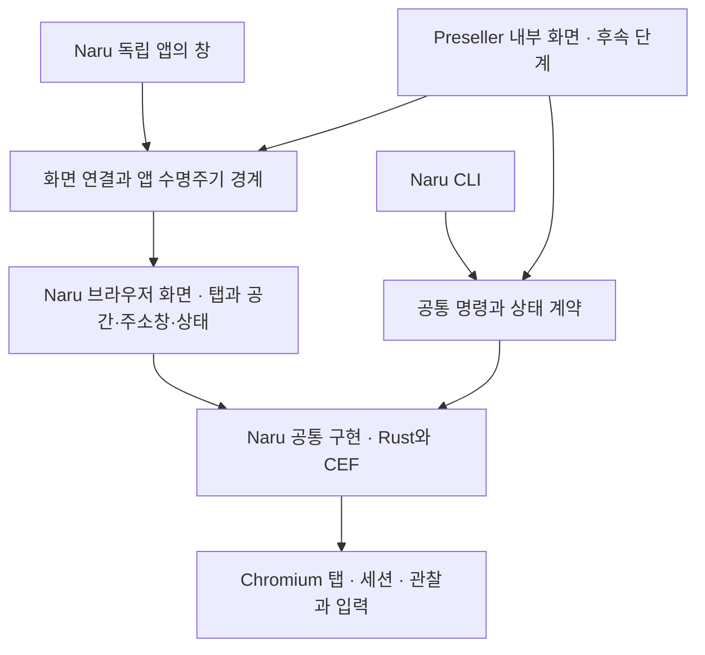

# Naru 독립 완성과 Preseller 내장 계획

방향 확정일: 2026-10-11. 사용자는 Naru를 먼저 ego lite처럼 사람과 AI가 함께 사용하는 독립 브라우저로 완성한 뒤, 같은 Naru를 Preseller 화면 안에 내장하려는 목적을 명확히 했다. Rust·CEF·Chromium과 CLI를 유지한다. 이 문서는 제품 방향과 후속 설계이며 공통 코어 추출이나 내장 구현의 완료 기록이 아니다.

2026-10-16부터 독립판의 남은 기능을 먼저 구현하고 통합 빌드 후 [단일 E2E 체크리스트](ego-parity-e2e.md)로 실제 앱을 검증한다. 반복 전체 회귀 결과를 쌓는 대신 같은 앱 해시에서 사람과 AI의 공동 사용, 파일 처리, 복구와 지속 사용을 확인한다. 이 완료 기준을 Preseller 연결 성공이나 별도 Naru 창의 원격 제어로 대체하지 않는다. 독립판 완성 후 같은 엔진을 내장하는 목표는 진행 중이다.

## 확정된 개발 순서

1. **Naru 독립 브라우저 완성:** 사용자 공간과 AI 작업 공간, 탐색·로그인·입력·파일 처리와 중지·복구를 실제 사용 흐름에서 안정화한다.
2. **같은 Naru를 내장할 수 있도록 분리:** 브라우저 화면·기능과 독립 창·앱 수명주기의 의존성을 나눈다. 탭·공간·주소창·작업 상태를 포함한 Naru 화면도 재사용 대상으로 두며, 독립 앱도 이 공통 구현을 계속 사용한다. 기능을 개발하는 동안 이 경계를 준비하되 완성 전에 Preseller 연결로 중심을 옮기지 않는다.
3. **Preseller에 내장:** Naru의 브라우저 화면과 제어 기능을 Preseller 안에 연결하고 상품 수집·이미지 처리·저장 흐름을 검증한다.

앞선 검토의 ‘Preseller Electron에 제어 규약을 이식하는 연결부터 시작’ 제안은 이 순서로 대체한다. 완성된 Naru를 재사용하는 것이 목표이며, Preseller 전용 브라우저를 별도로 구현하는 방향으로 바꾸지 않는다. 외부에 별도 Naru 창을 띄우는 연결만으로 내장 완료를 판단하지 않는다.

## 확인한 근거

- Naru의 `src/main.rs`는 AppKit 준비, CEF 초기화, 메시지 루프와 종료를 직접 소유한다. `src/control_panel.rs`의 `Shell::new`가 자체 NSWindow를 만들며 `src/browser.rs`의 `create_browser_with_context`는 그 창의 부모 뷰와 크기를 사용한다. 외부 앱의 뷰와 수명주기를 받는 연결 API는 없다.
- `src/protocol.rs`는 동일 사용자 로컬 소켓에서 요청당 JSON 응답 하나를 반환한다. CLI 명령과 작업 범위는 재사용할 수 있지만 호스트에 상태 변화를 전달하는 구독 계약은 없다.
- 사용자 공간과 AI 공간은 탭 선택·소유권을 구분한다. 모든 탭이 공유하는 프로필을 계정별로 격리하는 기능은 아니다.
- 기존 DOM `read`는 메인 프레임, 열린 Shadow DOM과 접근 가능한 iframe을 대상으로 한다. 후속 소스는 클릭, hover와 지원 키 42개 형식을 대상 확인 뒤 Chromium 입력으로 연결한다. 읽기의 focusedRef로 관찰 가능한 다음 포커스 대상을 찾으며 OS 포커스와 구별한다. 후속 텍스트 fill은 Chromium 입력 뒤 원래 대상의 값을 확인한다. insert는 현재 커서와 선택 영역을 유지해 부분 입력하며 입력칸의 값 확인과 HTML 편집기의 이벤트 관찰을 구분한다. contenteditable도 Chromium 입력을 사용하며 다른 입력 유형과 select, check는 DOM 동작을 유지하며 파일 입력은 `fill`에서 거부한다. 모의 DOM 검사와 독립 Chromium 관찰은 실제 Naru CEF 다중 프레임 검증과 구분한다. 엔진 접수 응답으로 페이지 효과나 물리 입력을 입증하지 않는다. 교차 출처 iframe의 읽기와 입력 7개는 아래 별도 API의 소스 구현 단계이며 포인터는 부모 좌표와 hit-test를 통과하는 축 정렬 기하만 지원한다. 일반적인 CEF 파일 선택창이나 HTTP(S) 로그인 redirect까지 작동하지 않는다는 판단은 하지 않았다. [iframe 계약](iframe-control.md), [포인터 입력](pointer-input.md), [키 입력](keyboard-input.md)의 검증 경계를 따른다.
- 기존 제어 명령의 raw 전송과 원 Browser 응답 확인을 공통 경로로 모았다. [프레임 연결](devtools-routing.md)은 현재 탭의 제한된 child session과 `frames TAB` 메타데이터 조회를 소스로 연결했다. 2026-10-18에는 `read-frame TAB FRAME`으로 교차 출처를 포함한 현재 문서 하나의 내용 조회를 연결했다. 원 Browser·session·문서·소유권과 정확한 context identity를 검사하고 고정 이름의 isolated world를 재사용한다. 정상 읽기는 Runtime 해제 ACK 뒤 응답하며 실패·취소 시 필요한 Runtime 및 autoAttach 정리 ACK를 추적한다. Runtime 해제는 이미 시작한 JavaScript 취소나 world 해제를 보장하지 않는다.
- 후속 `read-frame`은 원 문서에 결합한 ref와 focusedRef를 제공하며 `supportedActions`에 click·hover·fill·insert·press·check·select를 명시한다. [프레임 입력](frame-input.md)은 같은 session·unique context로 준비·입력·사후 확인을 연결하고, 부모 iframe의 상태와 원격 객체 해제를 확인한다. 탭마다 최신 묶음 하나에 최대 16개 문서·전체 120개 ref와 약한 DOM 참조를 보관한다. [read-page](page-read.md)는 기존 Rust·CEF 경로에서 문서들을 순차 조회하고 공통 예산과 각 원 문서의 바인딩을 유지한다. [프레임 포인터](frame-pointer.md)는 후보의 부모별 변환·clip·가림 검사와 mouseMoved 뒤 같은 위치 확인을 거쳐 root session으로 입력한다. 지원 밖 좌표 변환과 Preseller 호스트 연결 API는 미구현이다. [고정 엔진 조사](../artifacts/frame-input-v1-sources.json)와 소스 검토를 마쳤으나 실제 Naru CEF 입력·정리·지속 메모리와 E2E는 실행하지 않았다. 최신 빌드와 실행 여부는 [체크리스트](ego-parity-e2e.md)를 따른다.
- 다운로드 진행, 파일 지정, 권한 요청, 인증 완료 등을 Preseller에 전달하는 명시적 계약은 없다.
- 참조 대화 [preseller-app 완성 설계 및 구현](thread://01a00e45-5985-7803-9b45-1ac2449137fa?hostId=local)의 최근 기록에는 Electron 내부 저장·IPC와 Kotlin 서버가 등장한다. 상품 작업본, 재수집 충돌, 이미지 처리와 저장 복구가 이미 별도의 개발 대상이다. 이번에는 해당 프로젝트 소스를 직접 읽거나 실행하지 않았으므로 현재 구현 계약은 연결 전에 다시 확인해야 한다.

임시 페이지 포커스 준비와 해제, 입력칸 이벤트 대상 확인도 독립 앱의 공통 브라우저 계층에 둔다. [포커스 준비](focus-input.md)는 별도 UI renderer나 호스트 창 활성화 없이 요청의 exact session에서 처리한다. Preseller 내장에서도 이 수명과 사용자 화면 보존을 함께 검증해야 하며, 현재 소스 구현을 내장 완료나 실제 동시 입력 보장의 증거로 보지 않는다.

## 독립 브라우저의 완료 기준

ego lite는 사용자·AI 공간과 CLI 협업의 참고 제품이다. 기능이 동등하다고 판단하려면 항목별 실제 검증이 필요하며, 외관이나 로컬 검사 수로 동등성을 주장하지 않는다. 우선 다음 기준으로 Naru의 독립 사용 가능 여부를 판단한다.

아래 기준의 실제 판정은 [14개 사용 여정](ego-parity-e2e.md#하나의-통합-체크리스트)에 한 번만 기록한다. 같은 최종 바이너리의 근거가 없는 항목은 `pending`이나 `blocked`로 남기며 핵심 실패가 있으면 독립판 완료가 아니다. 소스 검사, 독립 Chromium 관찰과 이전 Naru 앱 결과는 현재 통합 실행과 구분한다. 로그인은 선택한 대표 서비스에서 사용자가 직접 진행하고, 탭 복원과 페이지 확대의 보류는 유지한다.

| 영역 | 필요한 동작과 검증 |
| --- | --- |
| 일반 사용 | 여러 탭 탐색, 팝업, 로그인 유지, 뒤로·앞으로, 다운로드·파일 선택이 대표 웹사이트에서 동작한다. |
| 사용자·AI 협업 | AI의 배경 작업이 사용자의 화면을 바꾸지 않는다. 본문에서 사용자가 개입할 때 제어권을 넘기고, 중지 후 이전 명령은 거부한다. 이미 실행된 동작은 취소 여부와 결과 불확실성을 구분한다. |
| AI 관찰·입력 | 현재 DOM 방식의 한계를 명시하고, 실제 대상 흐름에 필요한 iframe·CEF 입력을 검증한다. CLI가 페이지 준비·실패·중단을 구분해 응답한다. |
| 복구 | 탐색 실패, 렌더러 종료, 키체인 승인 대기 중 캡처 정체, 앱 재시작을 다룬다. 재시작으로 사라지는 작업과 복원할 탭을 구분하고 변경 명령을 무조건 재실행하지 않는다. |
| 자원 | 탭·캡처·대기 요청에 상한을 유지하고 작업 종료 후 자원을 회수한다. 같은 조건에서 전체 프로세스 메모리를 측정하며 반복 작업의 누적 증가를 확인한다. |

개발 환경에서 이 기준을 만족하는 것과 배포용 서명·공증·업데이트 준비는 별도로 기록한다. 지금 배포를 요구하는 계획은 아니다. 구체적인 웹사이트와 지원 시나리오는 실행 검증 전에 확정한다.

## 내장을 준비하는 구조

2026-10-20 파일 선택 E2E에서 내장 호스트와 관련된 엔진 제약을 확인했다. 현재 macOS `parent_view` 구성은 CEF Alloy를 사용하며 Chromium의 폴더 업로드 확인 모달을 표시할 호스트를 지원하지 않는다. v20에서 폴더를 고른 뒤 페이지 결과가 오지 않는 상태와 해당 탭을 닫을 때 exit 139를 관찰했다. 종료의 직접 원인은 스택 없이 단정하지 않는다. 파일 선택의 일반적인 성공을 폴더 지원이나 내장 호스트의 모달 지원으로 확대하면 안 된다.

현재 후속 소스는 폴더 요청을 명시적으로 취소하고 이유를 표시해 이 대기를 피한다. 폴더 지원은 미완료다. 같은 외부 부모 구조에서 CDP 호출만 바꾸는 방법도 디렉터리 열거 delegate의 제한이 남는다. 지원되는 CEF 모달 호스트 연결이나 엔진 보완을 검토하고, 독립판과 내장판 모두에서 실제 폴더 선택과 취소를 확인해야 한다. [파일 선택 계약](file-selection.md)의 고정 버전 원문과 실행 범위를 따른다. 별도 작업창을 추가하거나 Naru 내장 목표를 바꾸는 결정을 한 것은 아니다.

아래는 나눌 책임이며 아직 존재하는 crate나 공개 API 이름이 아니다.

- **공통 구현:** 탭, 세션, 탐색, 작업·공간 소유권, 관찰·입력, 캡처, 자원 제한을 담당한다. 상품 저장 같은 Preseller 업무는 여기에 넣지 않는다.
- **공통 브라우저 화면:** 탭·공간 전환, 주소창, 페이지 표시, 작업 상태와 중지를 포함한다. 현재 `control_panel`에 함께 있는 독립 창 생성과 이 화면의 책임을 나눠, 완성된 Naru 사용 흐름을 내장판에서도 재사용하도록 설계한다.
- **화면·수명주기 경계:** 부모 뷰, 크기·가시성·포커스, 팝업 배치, 닫기와 종료 요청을 받는다. 마지막 탭을 닫으면 독립 앱과 소켓까지 종료되는 현재 동작을 내장 호스트에 강제하지 않는다.
- **명령·이벤트 경계:** CLI와 내장 호출이 같은 작업 revision, 오류, 중지 규칙을 사용한다. 탐색·작업·파일·권한 상태의 이벤트, 요청 취소, 종료 중 늦은 콜백의 처리를 설계한다. 읽기 위주의 반복 polling을 필수 연결 방식으로 삼지 않는다.
- **호스트의 책임:** 프로필 경로와 계정 매핑, 키체인·앱 식별자, 권한·파일 선택 UI, 시작과 종료 순서, 자원 해제의 주체를 명시한다. 표시 공간을 로그인 격리로 취급하지 않는다.

처음부터 폴더만 여러 개로 나누기보다 현재 `main → control_panel → browser` 의존성을 실제 호출 경계로 분리한다. 독립 앱과 CLI 회귀 검사를 유지하고, 다른 호스트에서도 같은 제어 의미가 보존되는지 확인한다.

Preseller에 어떤 방식으로 Naru 화면과 CEF 뷰를 연결하고 앱 이벤트 루프를 조정할지는 기술 검증이 남아 있다. 현재 Preseller의 Electron과 별도 CEF를 함께 사용하는 구성에는 런타임·메모리 중복 비용이 생길 수 있다. 기존 호스트와의 연결 또는 호스트 변경은 Naru 재사용이라는 목표 안에서 비교하고, 구현 전에 결정한다. 같은 구현을 사용한다는 것이 독립판과 내장판의 실행 프로세스나 로그인 프로필을 반드시 공유한다는 뜻은 아니다. Rust 사용 자체를 메모리 절감의 근거로 삼지 않는다.

## 책임 구분과 첫 검증 범위

브라우저는 원본 사이트 표시, 사용자 로그인 참여, 탐색·조작, 수집 결과와 출처 전달을 맡는다. Preseller는 상품 작업본과 버전, 로컬 이미지 처리, 서버 저장과 재시도를 맡도록 연결하는 것을 제안한다. 두 곳에서 같은 상품 저장소나 작업 큐를 중복 운영하지 않는다.

독립 브라우저 기준과 내장 경계를 검증한 뒤, Preseller의 첫 연결 검증은 다음 흐름으로 제한한다.

1. Preseller 안에서 대상 상품 페이지를 연다.
2. 필요한 로그인이나 확인은 사용자가 같은 내장 화면에서 진행한다.
3. 상품 한 건의 데이터와 이미지 참조, 원본 URL을 추출한다. 범용 DOM 읽기와 상품별 추출기를 구분한다.
4. 기존 상품 작업본과 이미지 처리·서버 저장 흐름에 결과를 넘긴다. 요청 ID, 원본 수집 식별자, 상품 버전은 기존 계약 확인 후 맞춘다.
5. 사용자 화면을 AI가 가로채지 않는지, 중지 후 늦은 결과가 반영되지 않는지, 계정 전환·앱 재시작·저장 응답 유실 시 다른 상품에 결과가 섞이지 않는지 확인한다.

Preseller 고유의 계정 매핑과 수집 결과 계약은 이 실제 경로에 맞춘다. 외부 웹 콘텐츠가 Preseller의 내부 IPC나 서버 자격 증명에 직접 접근하지 않도록 경계도 확인해야 한다.

## 검증 수준과 남은 과제

기존 Naru UI 작업은 Rust 88개 검사, 로컬 CEF 공간 10항목, 단일 창 6항목 등의 근거가 있다(`artifacts/ui-polish-validation.json`). 이는 Preseller 연결이나 실제 수집 사이트 성공의 증거가 아니다. 이번 검토에서는 소스와 참조 대화만 읽었고 새 테스트·빌드·앱 실행은 하지 않았다.

연결 후에는 같은 페이지·탭 수에서 Preseller 전체 프로세스의 메모리와 종료 후 자원 회수를 측정해야 한다. 기존 Naru RSS 합계는 공유 매핑이 중복되므로 고유 RAM이나 연결 후 예상 메모리로 사용하지 않는다. 개발 서명으로 인한 키체인 승인 반복과 승인 대기 중 미리보기 복구도 남아 있다.
